# TP05 – Apache Kafka: Real-Time Data Streaming

## 11. Answers to the Report Questions

### Q1. What problem does Apache Kafka solve in a data-streaming architecture?

Kafka decouples the systems that produce data from the systems that consume it. Without it, every sensor would have to be connected directly to every application that needs its data, and readings stored only in static files would be analysed late. Kafka acts as a durable, distributed event log between them:

- Producers publish events once, and any number of independent consumers can read the same events.
- Events are stored on disk for a configurable time, so a consumer can read them later or replay them.
- It handles high throughput and scales horizontally through partitions.
- Consumers read at their own pace, so a slow consumer does not block the producer.

In this lab, the producer simulates smart-campus sensors, and different consumers (alerting, running average, building filter) process the same stream independently.

### Q2. Definitions

| Term | Definition |
|---|---|
| **Producer** | An application that publishes (writes) events to a Kafka topic. Here: `producer.py`. |
| **Consumer** | An application that subscribes to topics and reads (processes) events. Here: `consumer.py`. |
| **Broker** | A Kafka server that receives events from producers, stores them on disk, and serves them to consumers. Here: the `tp05-kafka` container (node 1). |
| **Topic** | A named category or feed of events, such as `campus-sensors`. |
| **Partition** | An ordered, append-only log that is a subdivision of a topic. A topic is split into one or more partitions to allow parallelism. |
| **Offset** | A sequential number that identifies the position of an event inside a partition. It is unique only within that partition. |
| **Consumer group** | A set of consumers sharing the same `group_id` that cooperate to read a topic. Each partition is assigned to only one consumer in the group, and the group's progress (offsets) is stored by Kafka. |

### Q3. What is the difference between a Kafka topic and a partition?

A **topic** is the logical name under which events are published (`campus-sensors`). A **partition** is the physical unit of storage and parallelism inside that topic. One topic is made of one or more partitions, and each partition is an independent ordered log with its own offsets.

In our lab, `campus-sensors` has 3 partitions (0, 1, 2), as shown by `kafka-topics.sh --describe` (Figure 10). Ordering is guaranteed only inside a single partition, not across the whole topic. When the producer sends without a key, the events are spread across the partitions, which is why the consumer group offsets differed per partition (Figure 11).

### Q4. Why does the consumer use `auto_offset_reset='earliest'`? When does this setting apply?

It tells the consumer where to start reading when it has **no valid committed offset** for a partition. With `earliest`, it starts from the oldest available event, so the consumer receives the messages produced before it started. The alternative, `latest`, would only show events produced after the consumer connects.

It applies when the consumer has no valid committed offset for a partition. This commonly happens when a consumer group reads that partition for the first time, or when its committed offset is outside the range of offsets still available (for example, after older records have expired).

If the group already has committed offsets, the consumer resumes from them and `auto_offset_reset` is ignored. This is why, when we re-ran `consumer.py` with the same group, it did not re-read old events (the group showed `LAG = 0`, Figure 11).

### Q5. What is the purpose of the consumer group ID? What happens if a new group ID is used?

The `group_id` identifies a consumer group. Kafka uses it to:

- **Share the work:** the partitions of a topic are divided among the consumers of the same group. Each partition is read by only one consumer of the group at a time.
- **Track progress:** Kafka stores the committed offsets per group, so the group can resume where it stopped.

If a **new** `group_id` is used, Kafka has no stored offsets for it, so `auto_offset_reset` applies. With `earliest`, the new group reads the whole topic from the beginning, independently of other groups. In our experiments, `consumer_extended.py` used the group `tp05-campus-average` and received all events, in parallel with `tp05-campus-monitor` (Figure 7 and Figure 8).

When two consumers use the **same** group, the events are split between them. In our test, the partition assignment was `(0, 1)` for one consumer and `(2)` for the other (Figure 12 and Figure 13).

### Q6. Why is JSON a suitable format for this exercise? Give one limitation.

**Why it is suitable:**

- It is human-readable, so we can inspect events directly in the terminal.
- It is supported natively in Python (`json.dumps` / `json.loads`), so serialization needs no extra library.
- It is flexible: we added the `campus_building` field without changing any schema definition.
- It is language-independent, so consumers could be written in any language.

**Limitation:** JSON has no enforced schema and is verbose. Field names are repeated in every message, so it uses more storage and bandwidth than binary formats (Avro, Protobuf), and nothing guarantees that producers and consumers agree on field names or types (a missing `temperature_c` would raise a `KeyError` in the consumer).

### Q7. Explain how Docker Compose simplifies deployment compared with starting services manually.

Without Compose, we would run a long `docker run` command with all ports, environment variables, volumes, and names, and repeat it exactly each time. With Compose:

- The whole configuration (image, ports, environment variables, volume, restart policy) is stored in one versioned file, `compose.yaml`.
- One command, `docker compose up -d`, creates and starts the configured services. `docker compose down` stops and removes the containers and network, but named volumes are preserved unless `-v` is added.
- The setup is reproducible: anyone who clones the repository gets the same Kafka broker.
- Useful commands are simple: `docker compose ps` and `docker compose logs kafka`.
- It scales easily if more services (for example a second broker or a UI) are added.

### Q8. What are the limitations of this single-broker educational setup compared with a production Kafka cluster?

| Aspect | This lab | Production |
|---|---|---|
| **Brokers** | 1 broker (also the only controller) | 3 or more brokers, with several controllers |
| **Replication factor** | 1 (no copies; `Replicas: 1`, `Isr: 1`) | Usually 3, with `min.insync.replicas = 2` |
| **Fault tolerance** | If the container stops, Kafka is unavailable and data may be lost | Survives broker failures through leader election |
| **Partitions** | 3 partitions on the same machine, so no real load distribution | Partitions spread across several brokers and machines |
| **Security** | `PLAINTEXT`, no authentication or encryption | TLS, SASL authentication, ACLs |
| **Networking** | Advertised listener `localhost:9092`, so only local clients work | Hostnames or DNS reachable by all clients |
| **Storage and monitoring** | One Docker volume, no monitoring | Dedicated disks, metrics, alerting, backups |

Therefore, in this lab partitions demonstrate consumer parallelism and ordering, but they do not improve availability or throughput across machines.

### Q9. Evidence

| Required evidence | Figure |
|---|---|
| Running container | Figure 2 (`docker compose up -d`) and Figure 19 (`docker ps`) |
| Topic description | Figure 10 (`campus-sensors`, 3 partitions, replication factor 1) |
| Producer output | Figure 4 (basic producer sending sensor events) |
| Consumer output | Figure 6 (events received, with high-temperature alerts) |
| Consumer groups and offsets | Figures 9, 11, 12, and 13 |

---

## 13. Screenshots and Experimental Evidence

This section presents the practical implementation and experimental results of TP05, following the order of the assigned tasks.

### 13.1. Task 1 – Kafka Broker Configuration Using Docker

**Figure 1. Docker Compose Configuration**

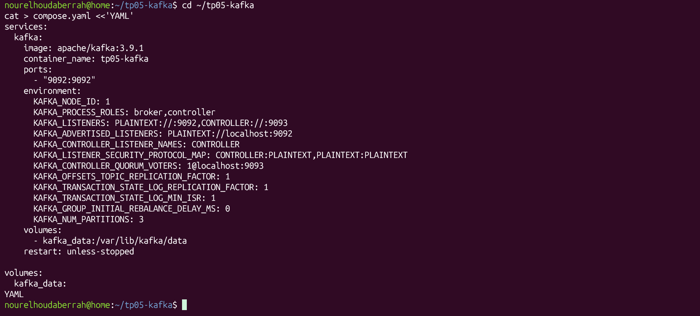

**Figure 2. Running Kafka Docker Container**

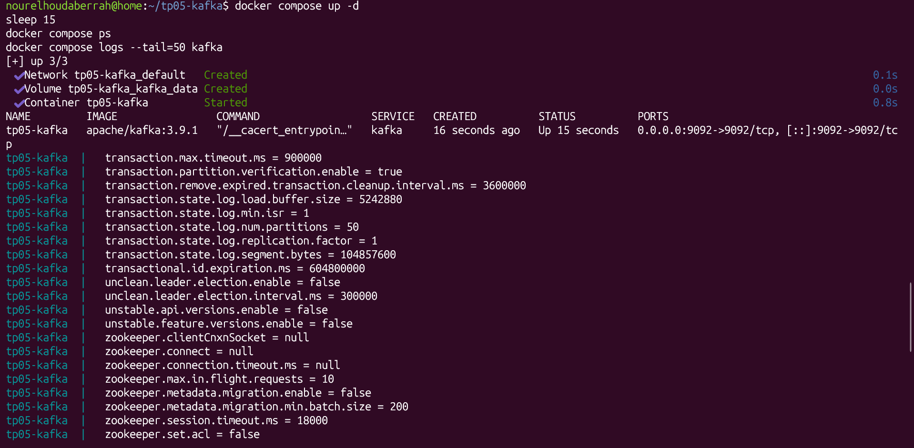

### 13.2. Task 2 – Python Environment and Kafka Client Installation

**Figure 3. Python Environment and Installed Kafka Client**

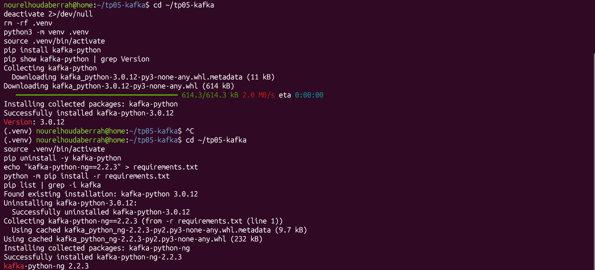

### 13.3. Task 3 – Kafka Producer Implementation

**Figure 4. Basic Producer Sending Sensor Events**

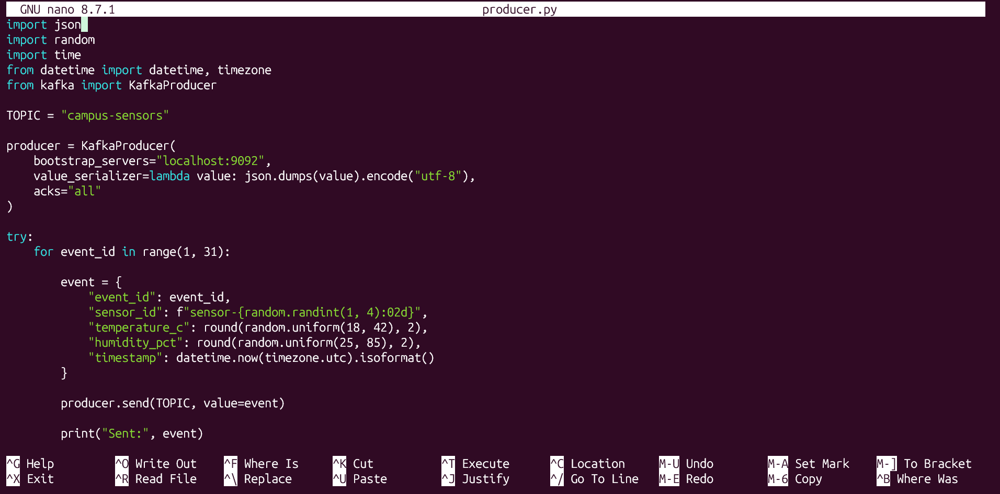

**Figure 5. Extended Producer Generating 100 Sensor Events**

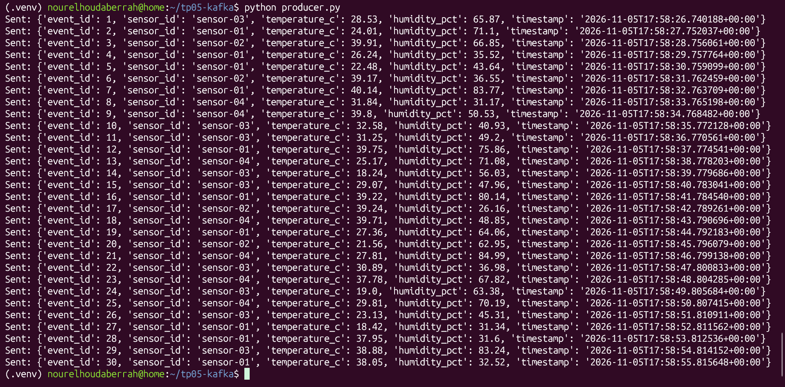

### 13.4. Task 4 – Kafka Consumer Implementation

**Figure 6. Basic Consumer Receiving Sensor Events**

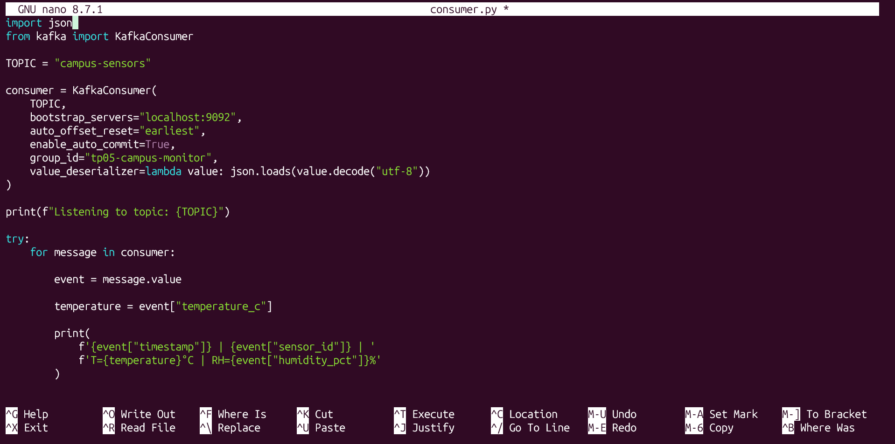

**Figure 7. Second Consumer Execution**

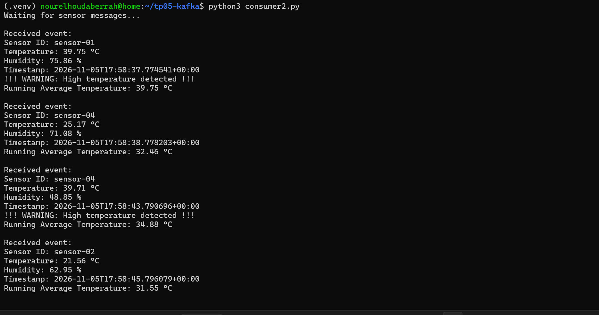

**Figure 8. Extended Consumer with Running Average, Temperature Alerts, and CSV Storage**

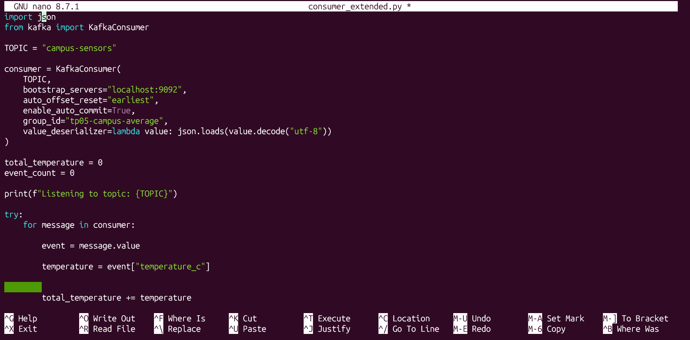

### 13.5. Task 5 – Kafka Topics and Consumer Groups Inspection

**Figure 9. Kafka Topics Inspection**

**Figure 10. Topic Configuration and Partition Information**

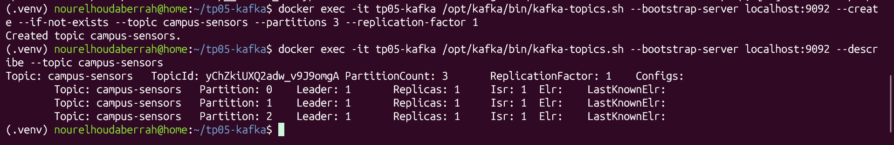

**Figure 11. Consumer Group Information**

### 13.6. Further Investigation – Consumer Groups Experiment

**Figure 12. Two Consumers Using the Same Consumer Group**

**Figure 13. Partition Assignment Between Two Consumers in the Same Group**

**Figure 14. Additional Comparison of Message Distribution**

### 13.7. Further Investigation – Partition Comparison

**Figure 15. Topic Configuration with Three Partitions**

**Figure 16. Comparison Between One and Three Partitions**

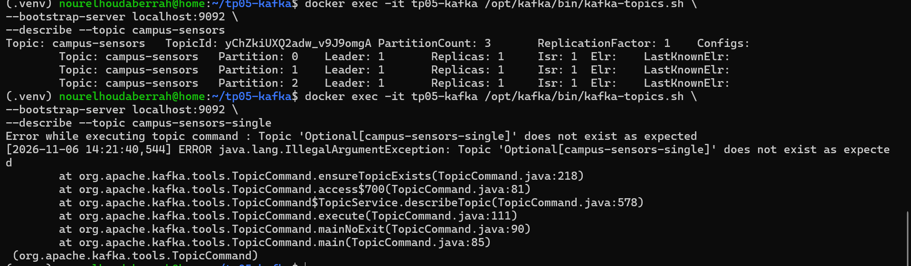

**Figure 17. Single-Partition Topic Configuration**

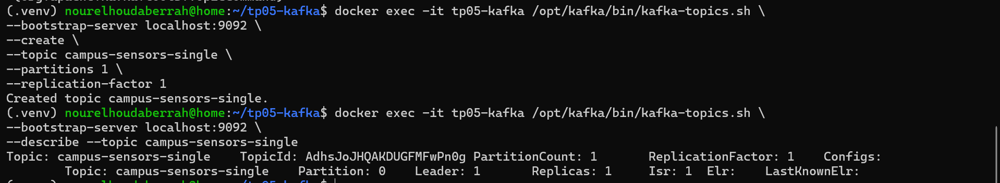

### 13.8. Further Investigation – Campus Building Information and Filtering

**Figure 18. Filtering Sensor Events for the Labs Building**

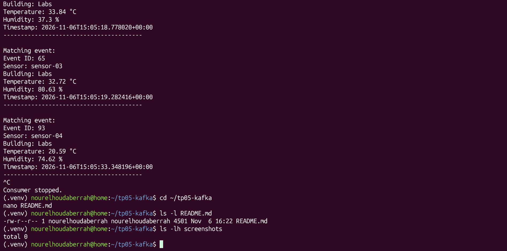

### 13.9. Additional Experimental Evidence

**Figure 19. Additional Kafka Terminal Output**

---

**End of TP05 – Apache Kafka: Real-Time Data Streaming**